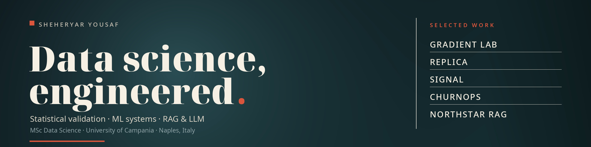

  

## I build data products where the claim is testable.

MSc Data Science at the University of Campania, with a computer science background and software engineering experience. I work on the part of data science that survives a reviewer: the analysis plan written down before the answer is known, the validation cohort the model has never seen, and the system that keeps running after the notebook closes.

The repositories below are built around claims you can check. Each one ships with the command that reproduces its numbers, and CI runs it on every push.

## Three that show how I think

**[Gradient Lab](https://github.com/imSheheryar/gradient-lab)** — a reverse-mode autodiff engine written from scratch in NumPy: 17 operations, an explicit graph, a hand-written backward pass, 41 tests including finite-difference gradient checks and parity checks against PyTorch. Then the part worth reading: 720 controlled runs on one task, varying only activation, initialisation, normalisation, residuals, depth and width. Depth 8 → 32 leaves a plain sigmoid network with 1.1e-17 of its first-layer gradient and chance-level accuracy. One residual connection takes the same network to 0.994. Sixteen times the width changes nothing. The probe classifies trajectories rather than snapshots, because a run that looks healthy at step 0 can be dead by step 250.
`NumPy` · `autograd` · `pytest` · `GitHub Actions`

**[Replica](https://github.com/imSheheryar/replica)** — [dashboard](https://imSheheryar.github.io/replica/) — a pre-specified replication of PAM50, one of the most cited breast cancer subtype systems, across TCGA-BRCA and METABRIC. The association holds in one cohort and not the other, and in neither does the subtype add enough on top of age, stage, ER and PR to reclassify a patient. Censoring-aware permutation tests, nonparametric combination, FDR control, NMF modules, and a clinical evidence dashboard.
`survival analysis` · `permutation tests` · `NPC` · `FastAPI` · `Plotly`

**[Signal](https://github.com/imSheheryar/signal)** — [dashboard](https://imSheheryar.github.io/signal/) — a multimodal nowcast of earnings-call volatility from what management says and how they say it: text and voice features, ablations showing which modality carries the signal, and a dashboard for the result.
`NLP` · `speech` · `LightGBM` · `Plotly`

## Systems work

**[ChurnOps](https://github.com/imSheheryar/churnops)** — [live demo](https://churnops-w0nb.onrender.com) — churn prediction treated as a service rather than a model: data contracts, MLflow registry gates, drift monitoring, Docker, CI, and a Render deployment.
`MLflow` · `FastAPI` · `Docker` · `GitHub Actions`

**[Clinical MLOps Pipeline](https://github.com/imSheheryar/clinical-mlops-pipeline)** — clinical risk classification with schema validation, XGBoost, MLflow tracking, FastAPI serving, and Pytest coverage across the pipeline.
`XGBoost` · `MLflow` · `FastAPI` · `Docker`

**[Northstar RAG](https://github.com/imSheheryar/northstar-rag)** — a retrieval-augmented assistant over a technical manual: hybrid retrieval over ChromaDB, HuggingFace embeddings, LangChain orchestration, Groq inference, Gradio interface.
`RAG` · `LangChain` · `ChromaDB` · `Gradio`

## Also on the shelf

| Project | What it is | Stack |
| :-- | :-- | :-- |
| **[HoopVision AI](https://github.com/imSheheryar/hoopvision-ai)** | Player and ball tracking, team assignment and possession from basketball video. | `YOLO` · `OpenCV` |
| **[SurvivalAnalysis-BioStats](https://github.com/imSheheryar/SurvivalAnalysis-BioStats)** | Kaplan-Meier, log-rank tests and OLS on Italian hospital data. | `lifelines` · `statsmodels` |
| **[Time-Series-Analyzer](https://github.com/imSheheryar/Time-Series-Analyzer)** | Interactive smoothing and functional-data explorer for time series. | `React` · `TypeScript` |
| **[AgroAdvisor](https://github.com/imSheheryar/AgroAdvisor-ML-and-AI)** | Crop recommendation from soil and climate features, model through to UI. | `scikit-learn` · `React` |
| **[Portfolio index](https://github.com/imSheheryar/Data-Science-Projects-Portfolio)** | The smaller notebooks and coursework, catalogued. | `Jupyter` |

## How I work

- Write the analysis plan before looking at the outcome.
- Validate on a cohort the model has never seen.
- Put the claim in the README and the command that reproduces it in CI.
- Prefer a diagnostic that tracks a trajectory to one that reports a snapshot.

## Toolkit

- **Statistics** — permutation tests · NPC · FDR control · survival analysis · NMF · clustering · external validation
- **Machine learning** — scikit-learn · XGBoost · LightGBM · PyTorch · TensorFlow · lifelines · SciPy · statsmodels
- **LLM and retrieval** — LangChain · LangGraph · ChromaDB · HuggingFace · Groq · OpenAI API · RAG evaluation
- **Engineering** — FastAPI · Docker · MLflow · GitHub Actions · Pytest · data contracts · drift monitoring · Render · AWS
- **Languages** — Python · R · SQL · Java · MATLAB · TypeScript
- **Visualisation** — Plotly · Matplotlib · Seaborn · Tableau · Power BI · React

## Currently

- MSc Data Science, University of Campania "Luigi Vanvitelli" (2025–2027). Thesis: multivariate analysis and external validation of breast cancer clinical profiles, using permutation tests and nonparametric combination.
- Available for data science and ML engineering roles: internships now, full-time from March 2027. Based in Naples, open to relocating within the EU.

## Elsewhere

[LinkedIn](https://www.linkedin.com/in/sheheryar-yousaf-01720a268/) · [imsheheryar.github.io](https://imsheheryar.github.io/) · [Email](mailto:imsheheryaryousaf@gmail.com)
