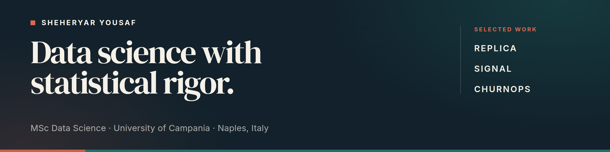

  

# Sheheryar Yousaf

I am an MSc Data Science student at the University of Campania, with a computer science background and software engineering experience. I build reproducible data science systems: pre-specified statistical analyses, external validation, and ML services that ship with tests, CI, and documentation. Previously a software engineer at Diginatives and a research associate at Hybytes.

My current research is an MSc thesis on multivariate analysis and external validation of breast cancer clinical profiles using permutation tests and the Nonparametric Combination (NPC) methodology.

## Selected work

- **[Replica](https://github.com/imSheheryar/replica)** · [dashboard](https://imSheheryar.github.io/replica/) — a pre-specified replication audit of PAM50 across TCGA-BRCA and METABRIC, with censoring-aware permutation tests, NPC, FDR control, external transport, NMF modules, and a clinical evidence dashboard. `Python` · `survival analysis` · `FastAPI` · `Plotly`

- **[Signal](https://github.com/imSheheryar/signal)** · [dashboard](https://imSheheryar.github.io/signal/) — a multimodal earnings-call volatility nowcast using text and voice, with ablations and an interactive dashboard. `Python` · `NLP` · `speech` · `LightGBM`

- **[ChurnOps](https://github.com/imSheheryar/churnops)** · [demo](https://churnops-w0nb.onrender.com) — a churn prediction platform with data contracts, MLflow registry gates, drift monitoring, Docker, and CI. `Python` · `MLflow` · `FastAPI` · `Docker`

- **[Clinical MLOps Pipeline](https://github.com/imSheheryar/clinical-mlops-pipeline)** — a clinical risk-classification pipeline with schema validation, XGBoost, MLflow tracking, FastAPI serving, Docker, and Pytest. `Python` · `XGBoost` · `MLflow` · `FastAPI`

- **[HoopVision AI](https://github.com/imSheheryar/hoopvision-ai)** — a computer-vision pipeline for basketball video: player and ball tracking, team assignment, possession, and annotated tactical views. `Python` · `YOLO` · `OpenCV`

- **[Northstar RAG](https://github.com/imSheheryar/northstar-rag)** — a retrieval-augmented chatbot over a technical manual with LangChain, ChromaDB, HuggingFace embeddings, Groq, and Gradio. `Python` · `RAG` · `LangChain` · `Gradio`

## How I work

- Pre-specify the question before looking at the answer.
- Validate out of sample, not only in the discovery cohort.
- Report effect sizes and intervals, not only p-values.
- Ship with tests, CI, and a README someone else can run.

## Toolkit

**Statistics and ML:** Python, R, scikit-learn, XGBoost, PyTorch, lifelines, SciPy, permutation tests, NPC, survival analysis  
**Data and engineering:** SQL, pandas, NumPy, FastAPI, Docker, MLflow, GitHub Actions, Plotly, Tableau, Power BI

## Currently

- MSc Data Science, University of Campania "Luigi Vanvitelli" (2025–2027)
- Thesis: multivariate analysis and external validation of breast cancer clinical profiles
- Open to data science and ML engineering roles in Italy or Europe

## Elsewhere

[LinkedIn](https://www.linkedin.com/in/sheheryar-yousaf-01720a268/) · [Email](mailto:imsheheryaryousaf@gmail.com) · [Replica dashboard](https://imSheheryar.github.io/replica/) · [Signal dashboard](https://imSheheryar.github.io/signal/)
